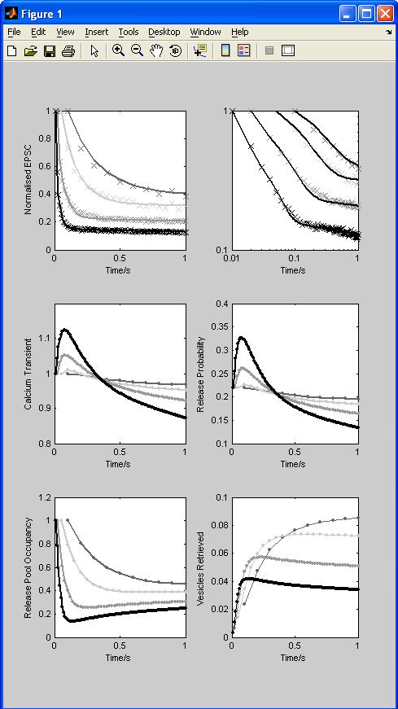

# Matlab scripts for simulation of synaptic depression at the Calyx of Held

These scripts were used for the simulations in the paper: Hennig MH, Postlethwaite M, Forsythe ID and Graham BP (2008). **[Interactions between multiple sources of short term plasticity during evoked and spontaneous activity at the rat calyx of Held](http://www.ncbi.nlm.nih.gov/pubmed/18450780?dopt=Abstract)**, *J Physiol*.

The following files are included in this archive:

- [fig2.m](fig2.m): Main simulation script, reproduces figure 2 in the paper (type "run fig2" after cd'ing to CalyxSTPModel folder):

- [mean_epscs.mat](mean_epscs.mat): Experimental data.
- [releasef.m](releasef.m): Function to simulate the EPSC amplitude during stimulation with a predefined spike train.
- [synOde.m](synOde.m): The ODEs of the model, called by releasef.m.

---

Mattias Hennig

Last modified: Sat May 3 22:01:48 BST 2008

---

2025-06-02: Standardized to Markdown.